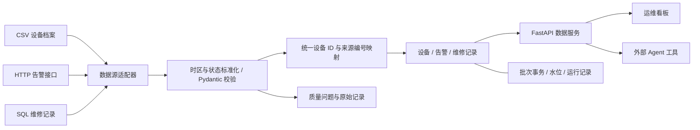

# OpsData · 工业运维数据中台

一个可在本地直接运行的数据中台 Demo。将 CSV 设备档案、HTTP 告警、SQL 维修记录接入统一模型，提供设备身份映射、增量同步、质量隔离、综合视图与事件时间线。

页面位于 `/`，交互式 API 文档位于 `/docs`。示例数据全部为合成数据。项目不调用大模型、不依赖 API Key，作为工业运维 Agent 的结构化数据服务使用。

详细介绍见 [工业运维数据中台：业务逻辑、使用流程与代码详解](docs/工业运维数据中台_业务与代码详解.md)，包含业务背景、Agent 支撑方式、核心代码执行链路和指标说明。

## 快速运行

需要 Python 3.11+ 和 [uv](https://docs.astral.sh/uv/)。在项目目录运行：

```powershell
uv sync --frozen
uv run --frozen python -m app.cli serve
```

或在 Windows 运行 `./start.ps1`。浏览器打开 <http://127.0.0.1:8000>，点击 **同步示例数据**。

更换端口：`uv run --frozen python -m app.cli serve --port 8010`。通过这个入口启动时，示例 HTTP 源会使用对应端口；如果已经创建过数据源，需要将数据库中该源的 URL 与实际端口保持一致。

首次启动自动创建 `data/platform.db`，并生成三个示例数据源及其文件。修改这些文件可以验证后续更新。启动时不会覆盖已有文件或数据库。

首次同步的预期结果：

| 输入 | 数量 | 处理结果 |
| --- | ---: | --- |
| 设备 CSV | 5 | 3 台有效设备、1 条批次重复、1 条缺失名称 |
| HTTP 告警 | 5 | 3 条有效告警、1 条无法关联设备、1 条非法告警等级 |
| 上游 SQLite 维修表 | 3 | 2 条有效记录、1 条负数费用 |

最终存储 **3 台设备、3 条告警、2 条维修记录**；质量问题页面留存 **5 条检查记录**。再次增量同步不会增加业务记录。全量校验会重复检查问题数据，因此质量问题历史记录数会增加。

## 架构与边界



- **后端**：FastAPI、SQLAlchemy、Pydantic；默认 SQLite，目标库存储可配置 MySQL。
- **数据源**：CSV 文件、HTTP JSON 快照、只读 SQLite 表。SQL 数据源适配器当前实现 SQLite；MySQL 是目标库的可选配置。
- **界面**：原生 HTML/CSS/JavaScript，支持增量同步、全量校验、设备搜索、编号映射、时间线、质量问题和运行历史。
- **集成**：设备详情与时间线 API 可作为 Agent 工具调用。本仓库不包含原运维 Agent、工单服务或真实工厂系统。
- **部署范围**：本地单机 Demo；写接口未实现登录鉴权，默认只监听本机地址。设备来源由配置指定，文件只允许在 `IMPORT_ROOT` 内，HTTP 只访问 `HTTP_ALLOWED_HOSTS` 中的主机且不跟随重定向。

## 可靠性设计

### 1. 统一设备身份

`devices.device_key` 是统一设备编号。`device_aliases` 的唯一键为 `(source_id, external_device_id)`。例如 `EQ-001`、`alarm-feed/PLC-A01` 和 `maintenance-db/M-1001` 关联同一台设备。关联失败的数据进入质量记录，不猜测匹配。

设备源维护别名映射。一个别名不能指向两台设备；冲突时通过保存点回滚整条设备记录，避免出现半条设备、半套映射。已有别名保留，便于关联历史事件；删除、迁移和合并设备需要额外业务策略，当前未实现。

### 2. 增量水位与幂等

- 水位是 `(updated_at, external_id)`，时间相同的多条记录依然有确定顺序。
- 输入时间必须带时区，转换为 UTC 后存储，API 返回 `Z` 时间。
- 唯一约束 `(source_id, external_id)` 防止重放导致重复入库。
- 同 ID、同版本、同内容不重复写入；同版本不同内容进入 `version_conflict`，要求来源更新 `updated_at`。
- 每批的业务记录、质量问题、统计计数和水位在同一个事务中提交。崩溃后保留已提交批次，未提交批次整体回滚。
- 来源数据库支持按更新时间增量，但本 Demo 适配器读取有大小限制的快照，再在接入层过滤水位；不是大规模分页 CDC。
- `updated_at` 必须随数据修改而单调推进。迟到数据、旧时间戳修复或新增旧记录需要 **全量校验**；当前没有回看窗口。

错误记录也会与水位一起提交，原始内容和原因可追溯。修复旧记录后应推进其更新时间或执行全量校验；缺少有效时间/ID 的错误记录不能推进水位，会在后续同步中再次被检查。

### 3. 并发与恢复

通过条件 `UPDATE` 抢占来源租约，同一数据源同时仅允许一个 Worker 同步；批次提交时续租。Worker 意外退出后，租约超时即可重新接管，并将旧运行标为 `abandoned`。正常异常会记为 `failed` 并释放租约。

单次 HTTP 请求超时为 10 秒。单次同步失败后可手动再次调用相同接口，或使用 CLI 周期调度自动再次尝试。当前没有独立消息队列或跨进程任务调度器；同步接口在请求期间完成任务，适合小规模演示。

### 4. 质量指标口径

页面统计最近 100 次运行的 **已处理输入记录**，并非去重后的业务库质量比例。全量重放和失败运行中已提交的批次也会计入。

| 指标 | 定义 |
| --- | --- |
| 必填字段完整率 | 所有必填字段存在且非空的记录数 / 已处理记录数；不代表类型与业务校验均通过 |
| 批次记录唯一率 | `1 - 同快照重复记录数 / 已处理记录数`；已存在且内容未变的记录不算批次重复 |
| 记录接收率 | 新增、更新和未变更记录数 / 已处理记录数 |
| 设备关联成功率 | 新增或更新的告警/维修记录中，编号关联成功次数 / 尝试关联次数；Schema 校验未通过与未变更记录不进入这个分母 |
| 最新记录年龄 | 当前时间 - 该源最新已接收记录的源更新时间；不代表整体积压或每条数据的传输延迟 |
| API P95 | 当前进程每条路由最近 1,000 次请求的服务端处理时间第 95 百分位；不包含客户端网络传输 |

运行满足：`read_count = inserted + updated + unchanged + rejected + duplicate`。API 同时暴露 `fetched_count`，用于区分读取的快照大小与增量处理量。

## 数据接口

| 接口 | 用途 |
| --- | --- |
| `GET /health` | 数据库与服务健康检查 |
| `GET/POST /api/sources` | 数据源查询与创建 |
| `POST /api/sources/{id}/sync` | 增量同步；请求体 `{"full":true}` 为全量校验 |
| `GET /api/devices?q=...` | 搜索设备 |
| `GET /api/devices/{device_key}` | 综合视图与来源编号 |
| `GET /api/devices/{device_key}/timeline` | 关联告警与维修时间线 |
| `GET /api/quality` | 质量统计与异常原始记录 |
| `GET /api/runs`、`GET /api/runs/{id}` | 运行结果与失败原因 |
| `GET /api/overview`、`GET /api/metrics` | 总览与真实请求耗时 |
| `POST /api/demo/run` | 按依赖顺序同步示例源；仅 Demo 模式开放 |

示例 Agent 工具调用：

```python
import httpx

with httpx.Client(base_url="http://127.0.0.1:8000") as client:
    device = client.get("/api/devices/EQ-001").raise_for_status().json()
    evidence = client.get("/api/devices/EQ-001/timeline").raise_for_status().json()
```

完整字段见 `/docs`。注册新 CSV 源示例：

```json
{"code":"extra-assets","name":"补充设备","kind":"csv","entity":"device","config":{"path":"extra-devices.csv"}}
```

各类型字段见 `app/schemas.py`，完整样例在首次启动生成的 `data/imports/`。示例源 `/demo-source/alarms` 从 `alarms.json` 读取，因此 HTTP 适配器确实发起本地 HTTP 请求。

## 定时同步与 MySQL

服务运行时，可在另一个终端执行：

```powershell
uv run --frozen python -m app.cli sync-all
uv run --frozen python -m app.cli sync-all --interval 60
```

默认 SQLite 已作为运行及测试目标。切换 MySQL：先创建数据库，将 `.env.example` 复制为 `.env`，填写 `DATABASE_URL=mysql+pymysql://...`，然后重新启动。MySQL 路径提供配置支持，但未在当前本地环境执行集成验证。

也提供 `docker compose up --build`；Docker 在当前开发环境未安装，镜像需在有 Docker 的机器上构建验证。

## 测试与可复现报告

```powershell
uv run --frozen ruff check .
uv run --frozen ruff format --check .
uv run --frozen pytest
uv run --frozen python -m scripts.verify
# 先启动服务并同步示例数据，再运行真实 HTTP 耗时测试：
uv run --frozen python -m scripts.benchmark --requests 100 --concurrency 5
```

- 测试覆盖三种接入方式、设备关联、数据隔离、幂等、版本冲突、时间标准化、批次回滚、中断续传、并发租约与 API 校验。单元/集成测试使用临时数据库，HTTP 源在测试中通过 MockTransport 隔离。
- `scripts.verify` 实际注入一次提交后中断，再恢复并全量重放；输出 `reports/recovery.json`。
- `scripts.benchmark` 发起真实 HTTP 请求，输出带环境、数据量、请求数、并发度和测量范围的 `reports/benchmark.json`。示例数据很小，结果只描述本地工作负载，不能当作生产吞吐量。
- `.github/workflows/ci.yml` 在推送和 Pull Request 时执行代码检查、测试与恢复验证。

## 目录

```text
app/
  adapters.py       # CSV、HTTP、只读 SQL 接入及边界限制
  models.py         # 数据源、统一设备、别名、事件、运行和质量记录
  schemas.py        # 数据协议与时间/状态标准化
  sync.py           # 租约、保存点、批次提交、水位和幂等
  main.py           # 数据服务 API、指标及页面
  demo.py           # 合成数据与示例数据源
  static/           # 运维数据看板
scripts/            # 恢复验证与真实 HTTP 耗时测试
tests/              # 自动化验证
```

后续可扩展真实数据库分页接入、消息队列与任务 Worker、权限隔离、迁移管理、可观测性导出，以及与实际运维 Agent 的工具注册集成。
