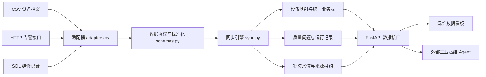
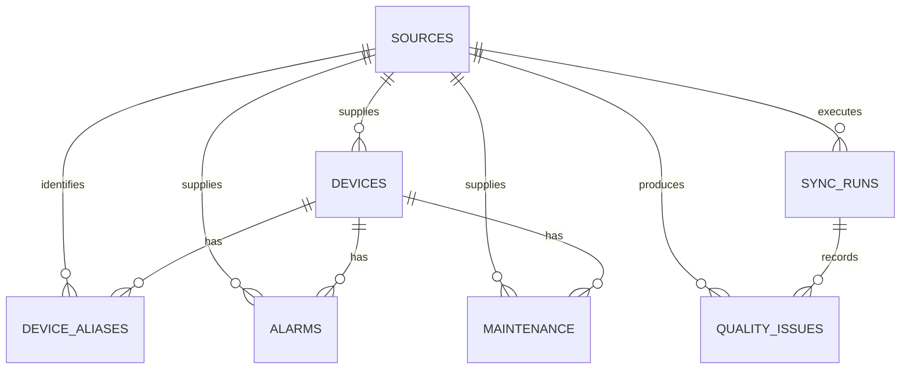
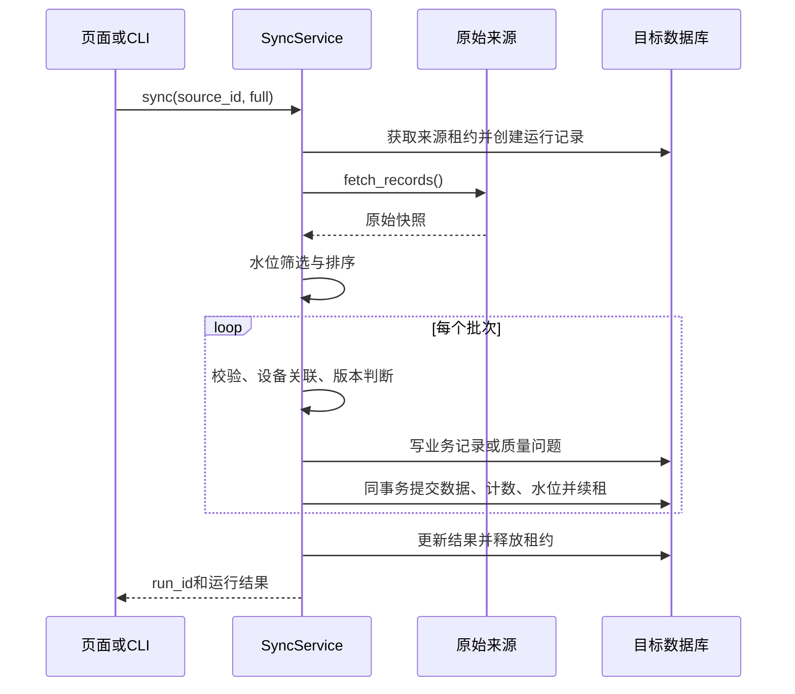
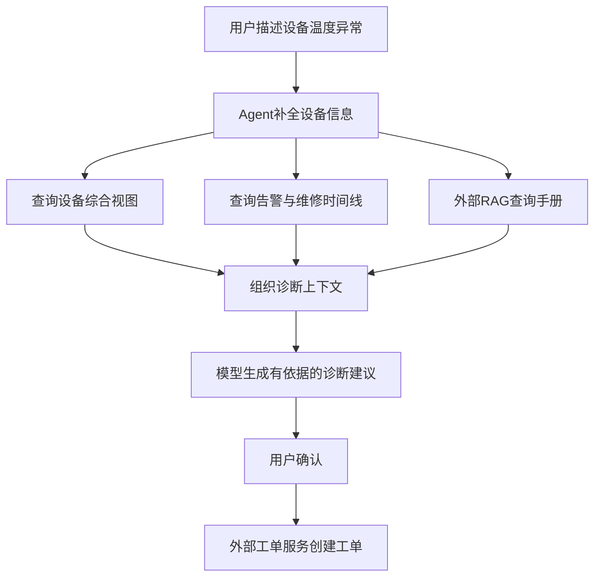

# 工业运维数据中台：业务逻辑、使用流程与代码详解

本文介绍当前 OpsData 项目的实际实现，适合项目学习、代码阅读、演示准备和技术交流。内容依据仓库代码及 2026-11-25 的本地验证记录整理。

平台已经完成 CSV、HTTP、SQL 数据接入，统一设备编号映射，数据校验，增量同步，质量追踪，以及设备综合视图和时间线 API。本地运行使用 SQLite；MySQL 目标库配置与 Docker 部署文件已经提供，尚未执行对应环境的集成验证。

## 目录

1. [项目定位与业务背景](#1-项目定位与业务背景)
2. [完整业务逻辑](#2-完整业务逻辑)
3. [系统架构与技术栈](#3-系统架构与技术栈)
4. [数据模型与设备身份](#4-数据模型与设备身份)
5. [数据接入与标准化](#5-数据接入与标准化)
6. [同步引擎的代码逻辑](#6-同步引擎的代码逻辑)
7. [对工业运维 Agent 的支撑作用](#7-对工业运维-agent-的支撑作用)
8. [运行与使用流程](#8-运行与使用流程)
9. [每个页面的作用](#9-每个页面的作用)
10. [主要 API 与返回内容](#10-主要-api-与返回内容)
11. [代码目录与阅读顺序](#11-代码目录与阅读顺序)
12. [质量与性能指标](#12-质量与性能指标)
13. [测试设计与验证结果](#13-测试设计与验证结果)
14. [当前实现边界与扩展方式](#14-当前实现边界与扩展方式)
15. [项目介绍与技术问题](#15-项目介绍与技术问题)

## 1. 项目定位与业务背景

### 1.1 数据中台承担什么职责

OpsData 将多个来源的设备相关数据整合为统一的数据服务，供运维 Agent 和看板共同使用。

| 业务对象 | 回答的问题 | 当前接入方式 |
| --- | --- | --- |
| 设备档案 | 这是什么设备，在哪里，目前登记的状态是什么？ | CSV 文件 |
| 告警记录 | 设备发生过什么异常，发生时间和等级是什么？ | HTTP JSON 接口 |
| 维修记录 | 设备做过哪些维修，由谁处理，费用是多少？ | 上游只读 SQLite 表 |

平台提供结构化事实和来源信息。故障原因推理、操作手册检索、人工确认和工单创建，由外部运维应用分别完成。

### 1.2 为什么运维 Agent 需要这一层

- **编号不同**：同一设备在档案、告警和维修系统中使用不同编号。
- **格式不同**：时间具有不同的时区，告警等级使用不同编码，费用和名称可能不合规。
- **接口分散**：每增加一个数据来源，Agent 都需要处理其字段和查询方式。
- **更新与重复问题**：同一条记录可能重复出现，或者内容已经更新。
- **故障难定位**：查不到数据时，需要区分来源没有记录、同步失败、校验拒绝和设备关联失败。

中台集中处理这些问题，使 Agent 主要关注任务目标和诊断流程。

### 1.3 设备身份的业务例子

用户反馈“一号空压机温度异常”。三个来源的编号如下：

| 来源 | 来源内编号 | 统一设备编号 |
| --- | --- | --- |
| `asset-registry` | `EQ-001` | `EQ-001` |
| `alarm-feed` | `PLC-A01` | `EQ-001` |
| `maintenance-db` | `M-1001` | `EQ-001` |

Agent 使用 `EQ-001` 即可查到这台设备的高温告警、振动告警和维修记录，不必自己猜测三个编号是否属于同一设备。

## 2. 完整业务逻辑

### 2.1 数据进入平台的过程

1. 注册来源，指定来源代码、接入方式、实体类型和连接配置。
2. 读取 CSV、HTTP 或 SQL 数据，得到原始记录列表。
3. 根据水位筛选本次需要处理的记录，并按水位排序。
4. 校验必填字段、类型、时间和业务取值。
5. 为告警和维修记录查找统一设备。
6. 对有效记录判断新增、更新或未变更。
7. 将重复、无效、冲突或无法关联的记录留存在质量问题表中。
8. 按批次提交业务数据、质量问题、计数和水位。
9. 对外提供设备查询、时间线和运行状态接口。

### 2.2 为什么先同步设备，再同步事件

事件必须先找到对应设备。告警先进入而设备映射尚未建立时，会产生 `unmapped_device`。

`POST /api/demo/run` 按以下顺序同步：

```text
asset-registry → alarm-feed → maintenance-db
设备档案         告警          维修记录
```

命令行 `sync-all` 也会优先处理设备类型的来源。如果事件先被拒绝，可在建立映射后对事件源执行全量校验，重新处理旧记录。

### 2.3 正常数据与问题数据如何分流

| 场景 | 处理 |
| --- | --- |
| 新的有效设备记录 | 新增设备并建立来源编号映射 |
| 同一记录内容未变 | 计入 `unchanged_count`，不重复入库 |
| 同一记录有更晚的更新时间 | 更新已有记录 |
| 同一版本出现不同内容 | 留存 `version_conflict`，要求来源推进更新时间 |
| 设备名称缺失 | 留存 `schema_validation`，拒绝该条记录 |
| 告警引用未知设备编号 | 留存 `unmapped_device`，拒绝该条记录 |
| 同一快照重复出现相同 ID 和更新时间 | 留存 `duplicate_in_batch`，重复条目不再处理 |
| 一个来源编号已经指向另一设备 | 留存 `mapping_conflict`，回滚该条设备及其别名写入 |

“同步成功”表示流程正常结束，不表示每条输入都通过检查。应同时查看拒绝数、重复数和质量问题。

## 3. 系统架构与技术栈

### 3.1 总体架构



采用模块化单体结构。适配器、校验、同步和查询具有清晰分工，通过一个 FastAPI 服务运行，便于本地启动和端到端验证。

### 3.2 技术栈与职责

| 技术 | 实际用途 | 选择原因 |
| --- | --- | --- |
| Python 3.11+ | 后端、转换、同步和验证脚本 | 便于数据处理和 Agent 集成 |
| FastAPI | 来源、设备、同步、质量和指标 API | 参数校验与交互式 API 文档 |
| Uvicorn | 运行 Web 服务 | 启动 FastAPI 应用 |
| SQLAlchemy | 模型、查询、事务、保存点 | 统一数据访问并支持不同目标库 |
| Pydantic | 字段协议、类型校验与标准化 | 在业务写入前检查数据 |
| SQLite | 默认目标库和示例维修来源库 | 不用另外安装数据库即可运行 |
| PyMySQL | 可选 MySQL 目标库驱动 | 通过配置切换目标库 |
| HTTPX | HTTP 来源接入、API 调用与耗时测试 | 超时、连接复用、测试传输层 |
| HTML / CSS / JavaScript | 操作页面和可视化状态 | 无需前端构建工具 |
| uv | 依赖与虚拟环境管理 | 使用 `uv.lock` 重现环境 |
| pytest | 功能、事务、恢复与 API 测试 | 自动验证关键行为 |
| Ruff | 代码与格式检查 | 发现常见错误并统一风格 |

项目也提供 Dockerfile、Compose 和 GitHub Actions 文件。当前实际运行验证以本机 SQLite 环境为准。

### 3.3 来源数据库与目标数据库

- **来源数据库**：SQL 适配器从 `data/imports/maintenance.db` 只读取得维修记录。
- **目标数据库**：存储平台自己的统一设备、事件、运行和质量数据，默认是 `data/platform.db`。

配置 MySQL 目标库，不会自动使来源适配器具备任意 MySQL 源的接入能力。

## 4. 数据模型与设备身份

模型定义见 [app/models.py](../app/models.py)。

### 4.1 七张核心表

| 表 | 模型 | 主要内容 |
| --- | --- | --- |
| `sources` | `Source` | 来源配置、水位、租约 |
| `devices` | `Device` | 统一编号、档案、源更新时间、内容哈希 |
| `device_aliases` | `DeviceAlias` | 来源编号到统一设备的映射 |
| `alarms` | `Alarm` | 设备关联、告警代码、等级、内容与事件时间 |
| `maintenance` | `Maintenance` | 设备关联、维修描述、人员、费用与维修时间 |
| `sync_runs` | `SyncRun` | 运行状态、处理计数、耗时、错误与起止时间 |
| `quality_issues` | `QualityIssue` | 错误类型、原因、来源记录、原始内容与对应运行 |



### 4.2 三种 ID 的区别

- `devices.id`：目标库内部主键，作为其他表的外键。
- `devices.device_key`：对外查询使用的统一编号。本实现取设备来源记录的 `external_id`。
- `device_aliases.external_device_id`：来源内部编号，例如 `PLC-A01`。

告警入库时，用 `(告警来源 ID, device_ref)` 查询别名表，得到内部 `device_id` 后写入告警表。

### 4.3 唯一约束

| 约束 | 作用 |
| --- | --- |
| `sources.code` 唯一 | 来源标识不重复 |
| `devices.device_key` 唯一 | 统一设备编号不重复 |
| 业务表 `(source_id, external_id)` 唯一 | 重放不产生多个相同业务记录 |
| 别名表 `(source_id, external_device_id)` 唯一 | 一个来源编号只能指向一台设备 |

设备身份来自明确映射，未使用名称相似度或大模型猜测。

## 5. 数据接入与标准化

### 5.1 适配器的统一输出

[app/adapters.py](../app/adapters.py) 中的 `fetch_records()` 对不同输入统一返回 `list[dict]`。同步引擎无需在业务规则中再次区分来源类型。

| 适配器 | 读取方式 | 限制 |
| --- | --- | --- |
| CSV | `csv.DictReader`，支持 UTF-8 与 UTF-8 BOM | 文件路径位于 `IMPORT_ROOT` 内 |
| HTTP | JSON 列表或 `{"items": [...]}` | 主机白名单、10 秒超时、禁止重定向、响应不超过 5 MB |
| SQLite | 只读连接和配置表 | 路径限制、表名校验、记录数量限制 |

单个来源快照最多 10,000 条。适配器读取有界快照，同步层执行水位筛选；当前没有源端分页或 CDC。

### 5.2 设备协议示例

下例符合 `DeviceRecord` 协议，日期用于说明格式：

```json
{
  "external_id": "EQ-001",
  "updated_at": "2026-11-25T09:00:00+08:00",
  "name": "一号空压机",
  "category": "空压机",
  "location": "A 车间 / 动力区",
  "status": "active",
  "aliases": {
    "alarm-feed": "PLC-A01",
    "maintenance-db": "M-1001"
  }
}
```

CSV 中的 `aliases` 是 JSON 字符串，由校验器解析成字典。别名对应的数据源需要先注册。

### 5.3 标准化与校验

[app/schemas.py](../app/schemas.py) 定义三种协议，主要规则包括：

- ID、名称、位置和维修人员等字段有非空或长度约束。
- 时间必须带时区，统一转换为 UTC。
- 设备状态只接受 `active`、`inactive`、`maintenance`。
- 告警 `HIGH` / `CRIT` 转为 `critical`，`WARN` 转为 `warning`，`LOW` / `INFO` 转为 `info`。
- 费用使用 Decimal，必须非负且满足金额精度限制。
- 未声明的额外字段会被拒绝，防止来源协议变化被忽略。

例如 `2026-11-25T16:00:00+08:00` 转为 `2026-11-25T08:00:00.000Z`。无时区输入被隔离为质量问题。

数据库按约定用无时区时间存储 UTC，API 通过 `iso()` 附加 `Z` 输出。

## 6. 同步引擎的代码逻辑

核心实现见 [app/sync.py](../app/sync.py)，入口为 `SyncService.sync()`。

### 6.1 执行顺序



### 6.2 来源租约

同一来源同时只允许一个同步执行者，通过条件更新取得执行权，逻辑等价于：

```sql
UPDATE sources
SET lease_owner = :token,
    lease_expires_at = :expires_at
WHERE id = :source_id
  AND (lease_expires_at IS NULL OR lease_expires_at < :now);
```

影响一行表示成功，否则抛出 `SourceBusy`，API 返回 409。默认有效期 300 秒，每次批次提交续租。UUID 同时作为执行者身份和本次 `run_id`。

接管过期租约时，遗留的 `running` 运行会标为 `abandoned`。旧执行者随后结束时，不会覆盖已经废弃的运行状态。

### 6.3 增量水位

水位为 `(updated_at, external_id)`。假设已提交水位是 `(08:00:00, EQ-001)`，同一时间的 `EQ-002` 排在其后，可以继续处理。

增量选择大于水位的记录；全量校验检查整个快照。排序使用时间加字符串 ID 的字典序。

两个边界需要注意：

1. 后来才出现，但更新时间早于水位的记录，增量不会自动发现。
2. 同一时间戳下，后来出现且 ID 排在水位之前的记录，也属于迟到数据。

这些情况需要推进来源更新时间或全量校验，当前没有回看窗口。无有效 ID 或时间的记录也会接受检查，但不能推进水位。

### 6.4 校验与设备关联

每条记录按 `entity` 选择协议：

```python
record = RECORD_TYPES[source.entity].model_validate(raw)
```

设备记录维护设备与别名，事件则通过别名找到内部 `device_id`。找不到映射时抛出 `RecordError("unmapped_device", ...)`。

设备及其所有别名位于同一个保存点内。即使前两个别名已经写入，第三个发生冲突，整条设备写入也会回滚。

### 6.5 幂等与版本判断

`upsert_record()` 先用 `(source_id, external_id)` 查询已有记录，再比较更新时间和内容哈希。

| 关系 | 处理 |
| --- | --- |
| 记录不存在 | `inserted` |
| 新输入的时间更早 | `unchanged`，保留较新版本 |
| 时间相同且内容相同 | `unchanged` |
| 时间相同但内容不同 | `version_conflict` |
| 新输入的时间更晚 | `updated` |

`digest()` 将校验后的数据按键排序、序列化为 JSON 后计算 SHA-256，避免字典键顺序影响判断。

批次重复和持久化幂等不同：前者检查本次快照已见的 `(updated_at, external_id)`，后者检查库中已存在的业务记录。

### 6.6 保存点隔离坏记录

保存点是大事务中的局部回滚点。一条记录出现可预期的校验或约束错误时，只回滚该条写入，保存错误并继续处理其他记录。

以下为解释结构的伪代码，不是可独立执行的完整实现：

```python
for batch in batches:
    for raw in batch:
        try:
            with session.begin_nested():
                record = validate(raw)
                outcome = upsert_record(record)
        except expected_record_errors as error:
            save_quality_issue(raw, error)
        advance_watermark_if_possible(raw)
    session.commit()
```

输入计数在进入保存点前刷新，设备关联计数在回滚时相应处理，确保被拒绝记录也有正确统计。

### 6.7 数据与水位一起提交

每批同事务提交业务记录、设备别名、质量问题、统计计数、水位和续租时间。

| 中断位置 | 恢复行为 |
| --- | --- |
| 本批提交前 | 本批整体回滚，下次重新处理 |
| 本批提交后 | 数据和水位都已保存，从后续位置继续 |

具备有效水位的问题记录，其错误和水位也会一起提交，避免每轮被同一错误阻塞。修复后的旧数据需要推进时间或全量校验。

### 6.8 结束与重试

正常结束标为 `succeeded`，执行失败标为 `failed`，保留错误和已提交进度。`finally` 只释放属于当前执行者的租约，防止误清除其他执行者的新租约。

同步接口在当前 HTTP 请求内完成工作。普通 `def` 接口由 FastAPI 在线程池执行，适配器本身采用同步读取。本仓库没有独立队列 Worker。

一次 HTTP 来源读取失败会结束本次运行，后续通过再次调用同步接口或 CLI 下一轮进行重试，当前没有适配器内部指数退避重试。

## 7. 对工业运维 Agent 的支撑作用

### 7.1 数据中台、RAG 和 Harness 的分工

| 部分 | 职责 | 例子 |
| --- | --- | --- |
| 数据中台 | 结构化事实、设备身份和来源 | 设备告警、维修历史、更新时间 |
| RAG 知识服务 | 文档知识和引用依据 | 手册中的高温故障排查步骤 |
| Agent 与 Harness | 组织任务、调用工具、管理上下文和执行状态 | 补充编号、查询证据、诊断、确认后建单 |

本仓库实现数据中台及看板，外部 Agent 可以调用其 API。原有 RAG、LangGraph 运维 Agent 和工单服务不在本仓库中运行。

### 7.2 一次故障诊断如何使用中台



例如 `EQ-001` 包含温度过高、振动趋势上升，以及更换滤芯的维修记录。Agent 可将这些事实与手册步骤结合，提出进一步检查建议。

事件相关性不直接证明故障原因，需要在输出中区分已知事实、推测和缺失证据。

### 7.3 可直接使用的只读工具函数

下例可放入外部 Agent 项目并封装为工具，调用当前已有的 API。

```python
from datetime import UTC, datetime
from urllib.parse import quote

import httpx


def get_device_context(device_key: str) -> dict:
    """读取统一设备档案和最近事件，供 Agent 组织诊断证据。"""
    key = quote(device_key.strip(), safe="")
    if not key:
        raise ValueError("device_key 不能为空")

    with httpx.Client(
        base_url="http://127.0.0.1:8000",
        timeout=5.0,
        trust_env=False,
    ) as client:
        device = client.get(f"/api/devices/{key}").raise_for_status().json()
        timeline = client.get(
            f"/api/devices/{key}/timeline",
            params={"limit": 20},
        ).raise_for_status().json()

    return {
        "device": device,
        "events": timeline["items"],
        "retrieved_at": datetime.now(UTC).isoformat(),
        "evidence_scope": "已接入来源的设备档案、告警及维修记录",
    }
```

在证据查询节点中调用：

```python
def evidence_node(state: dict) -> dict:
    context = get_device_context(state["device_key"])
    return {"device_evidence": context}
```

这里展示的是接入方法，仓库尚未把该节点注册进外部 LangGraph 图。

### 7.4 Agent 需要处理的异常

- **404**：追问或核对设备编号，不凭空补出设备资料。
- **接口超时或失败**：按 Harness 的重试预算处理，必要时说明暂时无法取得证据。
- **时间线为空**：只说明当前没有已接收的关联事件，不等于设备绝对没有历史告警。
- **数据较旧**：结合 `source_updated_at` 判断，避免将历史记录当作实时状态。
- **数据质量问题**：设备查询不会自动返回其所有来源错误，应由运维人员或独立工具结合 `/api/quality` 检查。

### 7.5 对 Agent 开发的直接价值

1. 来源结构变化集中在适配层处理，减少多个工具各自重复转换。
2. 设备身份通过确定性映射统一，减少模型承担编号匹配任务。
3. 事件附带来源代码、记录 ID 和更新时间，便于解释诊断依据。
4. 查询为空、数据过旧和同步异常能够分别定位，便于 Agent 选择追问或停止。
5. 同一套数据接口同时支持 Agent 和看板，便于人工核对模型使用的事实。

## 8. 运行与使用流程

### 8.1 启动

在 Windows PowerShell 中运行：

```powershell
Set-Location 'industrial-data-platform'
uv sync --frozen
uv run --frozen python -m app.cli serve
```

访问：

- 页面：[http://127.0.0.1:8000](http://127.0.0.1:8000)
- API 文档：[http://127.0.0.1:8000/docs](http://127.0.0.1:8000/docs)
- 健康检查：[http://127.0.0.1:8000/health](http://127.0.0.1:8000/health)

也可以运行根目录的 `start.ps1`。服务已经运行时，直接访问页面即可。

### 8.2 首次启动创建的内容

```text
data/
  platform.db               目标库
  imports/
    devices.csv             设备来源
    alarms.json             告警接口读取的文件
    maintenance.db          维修来源库
```

`seed_demo()` 创建来源配置与缺失的合成文件；后续启动不覆盖已有来源文件。

### 8.3 第一次同步

点击“同步示例数据”。在一份全新示例数据库中，预期结果如下：

| 来源 | 输入 | 有效入库 | 质量问题 |
| --- | ---: | ---: | --- |
| 设备 CSV | 5 | 3 台设备 | 1 条重复、1 条缺失名称 |
| HTTP 告警 | 5 | 3 条告警 | 1 条未知设备、1 条非法等级 |
| SQL 维修记录 | 3 | 2 条维修记录 | 1 条负数费用 |

最终形成 8 条业务记录、5 条质量问题。错误数据用于演示隔离机制。

### 8.4 演示记录更新

修改 `devices.csv` 中某条设备的名称或状态，将 `updated_at` 更新为更晚的带时区时间，执行设备源增量同步。

预期设备详情更新、`updated_count` 增加，设备总数保持不变。同 ID、同时间下仅改内容，会触发版本冲突。

### 8.5 修复旧错误记录

修复缺失字段或建立正确映射后，推进来源更新时间，或者执行全量校验。全量会重新检查旧记录，未变更的有效记录计入 `unchanged_count`。

质量表保存历史检查记录，当前没有自动把旧问题改成“已解决”的功能。因此修复后历史问题数量不会自动减少，全量检查还可能产生新历史记录。

### 8.6 周期同步

保持服务运行，在另一终端执行：

```powershell
uv run --frozen python -m app.cli sync-all --interval 60
```

每轮设备优先，轮次结束后等待 60 秒。某来源失败会打印错误，下一轮重新尝试。这是 CLI 轮询，没有额外任务调度平台。

### 8.7 添加自己的来源

1. 准备协议正确的 CSV / SQL 文件或白名单 HTTP 接口。
2. 在 `/docs` 调用 `POST /api/sources` 注册。
3. 先同步设备来源，再同步引用该设备的事件来源。
4. 查看来源水位、运行结果和质量问题，核对字段与关联。

注册 CSV 示例：

```json
{
  "code": "extra-assets",
  "name": "补充设备档案",
  "kind": "csv",
  "entity": "device",
  "config": {
    "path": "extra-devices.csv"
  }
}
```

文件应位于 `IMPORT_ROOT`。页面提供来源展示和同步按钮，新增来源通过 API 完成，目前没有创建来源表单。

## 9. 每个页面的作用

| 页面 | 展示内容 | 验证目标 |
| --- | --- | --- |
| 运行总览 | 数量、来源、水位、最近运行、质量统计与新鲜度 | 数据是否接入、是否异常、数据有多旧 |
| 设备数据 | 搜索、档案、来源编号和时间线 | 不同来源是否关联到正确设备 |
| 数据质量 | 来源、记录 ID、类型、原因和发现时间 | 哪些记录被隔离以及原因 |
| 同步记录 | 状态、处理计数、错误、耗时和 API 延迟 | 每次同步与重试是否可解释 |
| API 文档 | 接口协议和交互式请求 | 外部应用如何接入调试 |

原始问题数据 `raw` 可以通过 `/api/quality` 查看；当前页面展示问题摘要，没有原始 JSON 编辑器。

推荐演示顺序：总览同步 → 设备 `EQ-001` → 质量问题 → 同步记录 → 再次增量同步确认没有重复入库。

## 10. 主要 API 与返回内容

| 方法与路径 | 用途 | 关键参数或返回内容 |
| --- | --- | --- |
| `GET /health` | 服务及目标库检查 | `status`、`demo_mode` |
| `GET /api/sources` | 来源列表 | 配置、水位、最近运行和有效租约状态 |
| `POST /api/sources` | 注册来源 | 代码、名称、接入方式、实体类型和配置 |
| `POST /api/sources/{id}/sync` | 同步 | 请求体 `{"full": false}`；全量为 `true` |
| `GET /api/devices` | 搜索 | `q`，`limit` 默认 100、最大 200 |
| `GET /api/devices/{device_key}` | 综合视图 | 档案、别名、事件数量、源更新时间 |
| `GET /api/devices/{device_key}/timeline` | 时间线 | `limit` 默认 50、最大 200 |
| `GET /api/runs` | 运行历史 | `limit` 默认 50、最大 200 |
| `GET /api/runs/{run_id}` | 运行详情 | 状态、计数、耗时、质量与错误 |
| `GET /api/quality` | 质量统计和问题 | `run_id` 过滤问题列表，`limit` 最大 500 |
| `GET /api/overview` | 总览 | 数量、质量、记录年龄、同步 P95 |
| `GET /api/metrics` | API 耗时 | 路由样本数、P50、P95 |
| `POST /api/demo/run` | 顺序同步示例源 | 仅 `DEMO_MODE=true` 开放 |

`/api/quality?run_id=...` 按运行过滤问题列表，但汇总质量仍统计最近 100 次运行，响应中的 `scope` 会说明范围。

时间线先分别查询该设备最近的告警和维修，再按事件时间降序合并，返回前 `limit` 条。每条事件保留类型、来源 ID、来源代码和源更新时间。

响应头 `X-Request-ID` 标识一次 HTTP 请求，`Server-Timing` 提供服务端耗时。`run_id` 标识一次同步运行，两者含义不同。

## 11. 代码目录与阅读顺序

### 11.1 文件职责

```text
industrial-data-platform/
  app/
    config.py          环境变量、路径、批次与租约配置
    db.py              Engine、Session、建表与 SQLite 配置
    models.py          核心表、外键、索引和唯一约束
    schemas.py         字段协议及时间、等级转换
    adapters.py        CSV、HTTP、只读 SQLite 接入
    sync.py            幂等、保存点、水位、租约与同步恢复
    demo.py            合成文件与来源配置
    main.py            应用生命周期、API、查询和耗时统计
    cli.py             启动、初始化、单次及周期同步
    static/
      index.html       页面结构
      style.css        样式和响应式布局
      app.js           API 调用、渲染、同步和设备详情交互
  tests/
    conftest.py        临时数据库、测试应用、HTTP MockTransport
    test_platform.py   功能与可靠性测试
  scripts/
    verify.py          恢复与重放验证
    benchmark.py       真实 HTTP 往返耗时测试
  docs/                技术文档和验证记录
  reports/             脚本生成的本地报告
  pyproject.toml       依赖与检查配置
  uv.lock              锁定依赖版本
  .env.example         环境配置示例
  start.ps1            Windows 启动入口
  Dockerfile           容器构建
  compose.yaml         端口映射与数据目录挂载
```

### 11.2 阅读顺序

1. `schemas.py`：输入有哪些字段，什么数据会被拒绝。
2. `models.py`：数据存在哪里，设备和事件如何关联。
3. `adapters.py`：来源如何转换为记录列表。
4. `sync.py`：沿 `sync()` 阅读租约、筛选、校验、保存点、提交和恢复。
5. `main.py`：同步如何被 API 调用，数据如何组合成设备视图。
6. `static/app.js`：页面如何使用这些接口。
7. 测试与验证脚本：用可复现行为检查自己的理解。

### 11.3 启动与请求处理

`app.cli serve` 启动 Uvicorn，导入 `app.main:app`。`create_app()` 创建配置、数据库对象和同步服务，在 FastAPI 生命周期入口中建表，并按 Demo 模式生成示例配置及文件。

查询请求通过依赖获得独立 Session。同步服务自行管理内部 Session 与批次事务，避免把整个同步过程放进一个页面查询事务中。

### 11.4 前端代码

`refresh()` 并行请求总览、来源、设备、质量、运行和指标，再分别渲染。

- 同步期间禁用相关按钮，结束后刷新展示。
- 设备搜索使用短延迟合并输入请求。
- 点击设备后读取详情和时间线。
- 来源文本主要通过 `textContent` 放入 DOM，避免按 HTML 执行。

按钮禁用改善交互，真正的并发保护由后端租约承担。

## 12. 质量与性能指标

### 12.1 统计范围

质量指标取最近 100 次运行的已提交处理记录。全量重放会再次计入；失败运行已提交的批次也会计入。

| 指标 | 公式或含义 |
| --- | --- |
| 必填字段完整率 | 必填字段均存在且非空的记录数 ÷ 已处理记录数 |
| 批次记录唯一率 | `1 - duplicate_count / read_count` |
| 记录接收率 | `(inserted_count + updated_count + unchanged_count) / read_count` |
| 设备关联成功率 | 新增/更新事件中编号关联成功次数 ÷ 实际尝试关联次数 |
| 最新记录年龄 | 当前时间 − 此来源最新已接收记录的源更新时间 |
| API P95 | 当前进程每路由最近 1,000 次请求的服务端处理时间第 95 百分位 |

无样本时返回 `null`，避免误表示为 0% 或 100%。完整率只判断是否存在且非空，不代表类型和业务校验通过。关联指标不含 Schema 校验失败和未变更记录。

### 12.2 首次同步的数字

首次 13 条输入中，8 条新增、4 条拒绝、1 条批次重复：

```text
read_count = inserted + updated + unchanged + rejected + duplicate
13         = 8        + 0       + 0         + 4        + 1
```

仅缺失名称的一条不满足完整性，因此完整率为 `12 / 13 ≈ 92.31%`。批次唯一率也是 `12 / 13 ≈ 92.31%`。

关联尝试共 6 次，成功 5 次，关联成功率为 `5 / 6 ≈ 83.33%`。非法告警等级和负数费用在 Schema 阶段失败，没有进入关联分母。

### 12.3 耗时口径

P95 的实现是排序后取 `ceil(样本数 × 0.95)` 位置的值，100 个样本时取第 95 个。

| 耗时 | 范围 |
| --- | --- |
| 同步运行耗时 | 一次同步的总时间；`sync_p95_ms` 取最近有耗时值的运行，可能包含失败运行 |
| API 服务端耗时 | 中间件记录的处理时间，不含客户端网络；重启清空样本 |
| 客户端请求耗时 | `benchmark.py` 发起请求的实际往返时间 |

最新记录年龄不等于同步延迟。很旧但刚接收的维修记录，仍会显示较大的记录年龄。

## 13. 测试设计与验证结果

### 13.1 自动化测试

截至 2026-11-25，21 项测试通过，并通过 Ruff 检查。覆盖范围包括：

- 三种接入方式和统一设备关联。
- 增量重复、全量重放、更新已有记录。
- 同版本内容冲突和设备别名冲突。
- 质量分母、错误分类、时区转换与无时区拒绝。
- 已提交批次恢复和未提交批次回滚。
- 来源租约互斥、过期接管和旧运行状态。
- HTTP 失败时水位不推进。
- 文件路径、HTTP 配置和 SQL 表名限制。
- API 参数、搜索、静态页面和耗时样本。
- 同时间戳复合水位及迟到记录全量重放。

测试使用临时数据库和 HTTPX MockTransport；页面联调则实际访问本地 HTTP 告警来源。

```powershell
uv run --frozen ruff check .
uv run --frozen ruff format --check .
uv run --frozen pytest
```

### 13.2 恢复验证

```powershell
uv run --frozen python -m scripts.verify
```

在隔离数据库中设置每批 2 条，提交第一批后注入异常，再恢复同步并全量重放。实际记录：

| 检查项 | 结果 |
| --- | --- |
| 中断触发 | 是 |
| 中断后已有设备 | 1 台 |
| 恢复后新增 | 2 台 |
| 恢复后设备总数 | 3 台 |
| 全量重放新增 | 0 台 |
| 全量重放未变更 | 3 台 |

这是特定异常边界的恢复验证，不是实际断电实验。原始结果在 `reports/recovery.json`。

### 13.3 本地 HTTP 耗时

先启动并同步数据，再运行：

```powershell
uv run --frozen python -m scripts.benchmark --requests 100 --concurrency 5
```

2026-11-25 的一次实际结果：

| 条件或结果 | 数值 |
| --- | --- |
| 环境 | Windows 11、Python 3.12.9、SQLite |
| 数据量 | 3 台设备、3 条告警、2 条维修记录 |
| 接口 | `GET /api/devices/EQ-001` |
| 请求数 / 并发度 | 100 / 5 |
| 成功请求数 | 100 |
| 客户端 P50 | 10.911 ms |
| 客户端 P95 | 28.252 ms |
| 本轮吞吐 | 415.26 requests/s |

一次预热未计入。报告在 `reports/benchmark.json`。这是小型本地合成数据集的结果，不能推断真实工厂规模或生产吞吐。

## 14. 当前实现边界与扩展方式

### 14.1 实现边界

| 方面 | 当前状态 |
| --- | --- |
| 来源 | 合成设备、告警、维修，未连接真实工厂系统 |
| 目标库 | SQLite 已测试；MySQL 支持配置，尚未集成验证 |
| 执行方式 | 请求内同步或周期 CLI，无消息队列和后台任务中心 |
| 增量 | 有界快照加水位，无 CDC、源端分页和迟到回看窗口 |
| 设备治理 | 显式映射，无自动模糊匹配、合并和删除传播 |
| 权限 | 默认监听本机，未实现登录、多租户权限 |
| 质量治理 | 留存历史，没有“已解决”状态流转 |
| 查询 | 搜索和数量限制，无大结果集游标分页 |
| 统计 | 数量、质量、新鲜度、运行与耗时，没有独立聚合分析接口 |
| Agent | 提供可调用 API，外部工具注册需由接入方完成 |
| Docker | 构建和运行配置已提供，当前环境尚未验证 |

### 14.2 扩展位置

- 新来源协议：扩展 `adapters.py`，补充配置校验和适配测试。
- 新业务实体：增加 Schema、业务表、类型映射和入库逻辑。
- 来源字段映射：在接入与 Schema 校验之间增加显式转换层。
- 迟到容忍：增加回看窗口，继续依赖幂等机制去重。
- 后台任务：将 `SyncService` 作为 Worker 的执行入口，保留事务边界。
- 权限：为来源和设备增加资源归属，并在读写与同步入口统一校验。
- Agent 接入：将设备详情和时间线封装成工具，注册到证据查询节点。

## 15. 项目介绍与技术问题

### 15.1 简短项目介绍

本项目面向工业运维 Agent 和数据看板，整合设备档案、告警及维修记录，通过统一设备编号映射和数据校验形成一致的数据视图。后端基于 FastAPI、SQLAlchemy 和 Pydantic，提供多源接入、增量同步、幂等写入、质量追踪和设备查询服务，通过批次事务、水位和来源租约支持同步恢复与并发控制。

### 15.2 为什么不由 Agent 直接查询原系统

来源少且稳定时可以直接查询。来源增加后，编号关联、时区转换、质量检查和接口适配会散落在多个工具中。中台集中管理这部分规则，供 Agent 和看板复用，并提供统一追踪入口。

### 15.3 为什么同时需要唯一约束和哈希

唯一约束防止同一来源记录生成多个业务实体，时间与内容哈希区分新版本、未变更和同版本冲突。

### 15.4 为什么同时需要保存点和批次事务

保存点隔离单条坏记录，避免常见输入错误打断整批；批次事务保证业务数据、质量问题、计数和水位一起提交，定义可靠的恢复边界。

### 15.5 如何介绍性能结果

同时说明接口、数据量、请求数、并发度、环境和测量范围。已有数字仅证明当前本地工作负载的请求表现，不应描述成生产规模下的性能承诺。

## 相关文件

- [快速运行与项目说明](../README.md)
- [本地验证记录](validation.md)
- [同步引擎](../app/sync.py)
- [数据协议](../app/schemas.py)
- [数据库模型](../app/models.py)
- [API 实现](../app/main.py)
- [自动化测试](../tests/test_platform.py)
